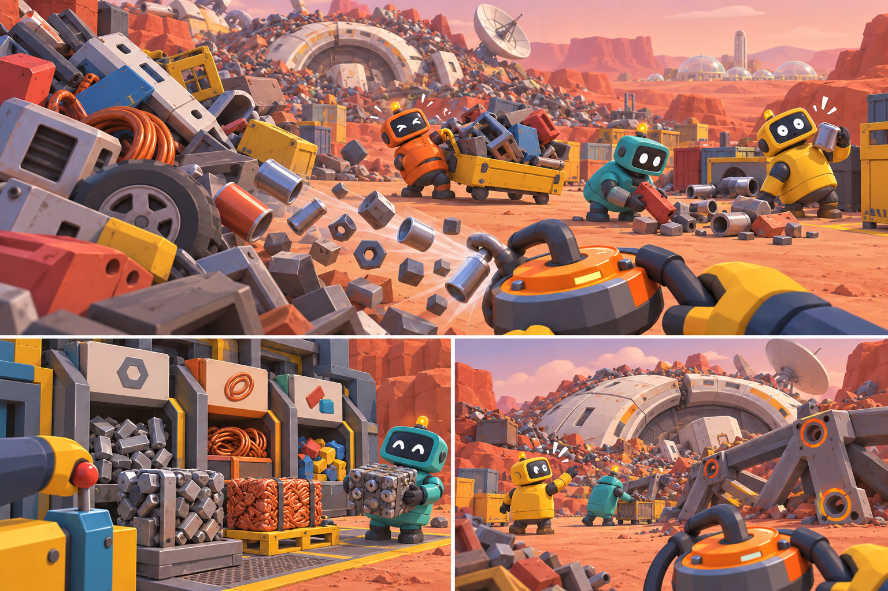
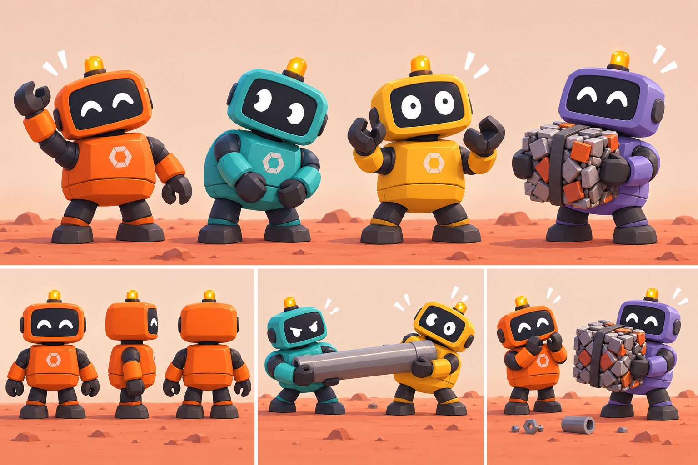
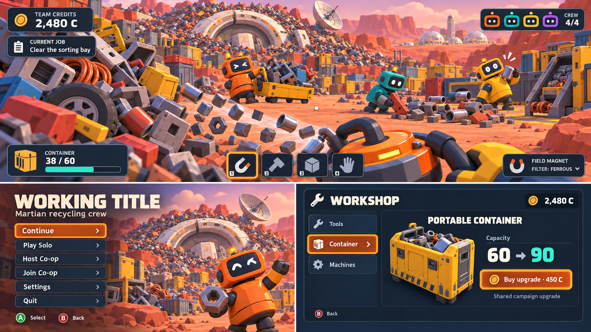
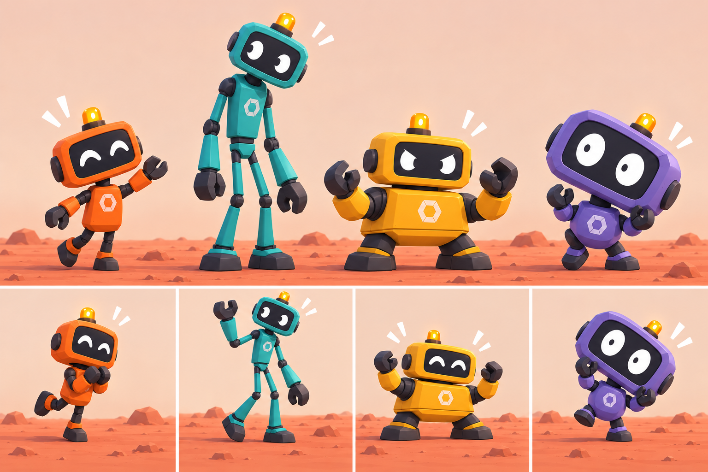
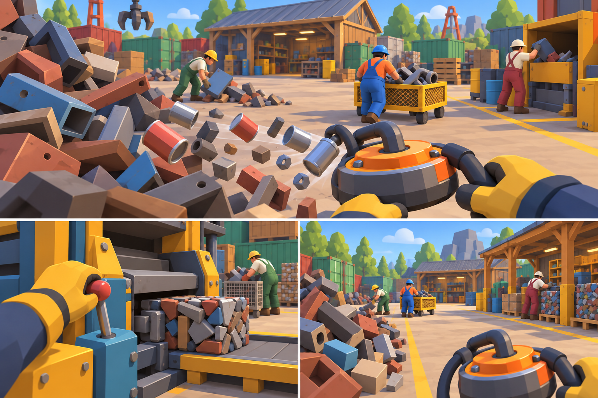
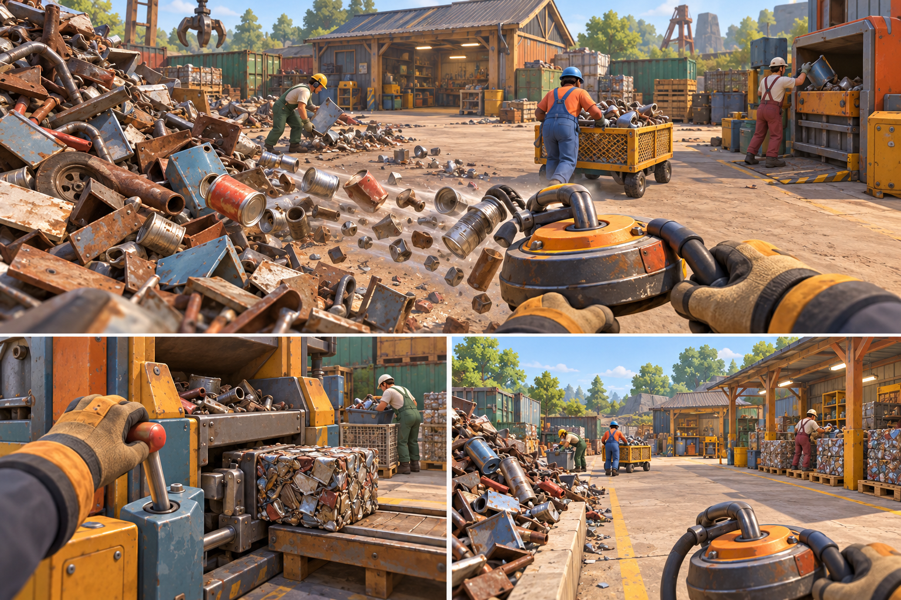

# Martian Scrap Co. — Visual Art Direction

**Version:** 1.2 · **Date:** 2026-10-29 · **State:** approved visual anchors plus proposed production/marketing-context rules; no reapproval or runtime assets produced.

The target is a simple, colorful, stylized industrial Mars scrapyard populated by funny, expressive recycling robots. Favor readable silhouettes, satisfying material shapes and a clear sense of scale over realistic grime or dense microdetail. The yard becomes cleaner and the buried station becomes more visible as the campaign progresses.

**Related:** [Product requirements](01-product-requirements.md) · [Technical architecture](03-technical-stack-architecture.md) · [Phased task plan](04-phased-agent-task-plan.md).

## 1. Status and visual hierarchy

**Approved** means selected by the user. **Proposed** means a production recommendation to review in an in-engine pilot. **Validation required** means it needs evidence on the actual game and target devices. Concepts establish direction; they are not screenshots, 3D models, texture sheets or proof of performance.

Priority order: recognizable interaction first, overall art style second, decorative detail third. Keep the large scrap mountain visually rich through repeated shapes and grouped masses, not by making every rendered screw a simulated collectible. Preserve a readable foreground against the warm terrain. Proposed lighting uses a warm key, soft cool shadows and gentle distance haze; it must not hide material identification or make the game look like a survival emergency.

## 2. Approved environment and gameplay anchor

[Open reference](../references/scrap-magnet-mars-gameplay-concept.png)

**Role: approved environment and gameplay reference.** The top panel combines first-person collection, a huge mixed scrap mountain, rounded robots, carts and distant colony domes. The lower panels show a physical sorting/compaction area and the gradual station reveal. These are composition cues, not exact geometry, capacities or mechanics specifications.

**Approved interpretation:** this is a grounded **surface station on Mars**, gradually exposed in one connected yard and dismantled in the finale. The circular station structure can read as an abandoned habitat/service complex. Do not introduce orbital travel merely because the structure looks spacecraft-like. Colony domes provide a hopeful destination for recovered material without requiring an explorable second settlement.

**Proposed environment kit:** broad terrain terraces; modular station rings, doors and utility panels; gantries; intake hoppers; compactors; conveyors; carts; road markings; rock silhouettes; distant colony structures. Start with a small reusable kit and use orientation, scale, paint and authored clustering to vary it. Avoid repeated identical junk piles at every sector entrance.

The campaign needs visual progression as well as content progression. Initial clutter should partly obscure station landmarks; each sector uncovers a recognizably different portion. Cleared ground, new route markings and exposed supports remain readable from useful return viewpoints. Proposed before/after camera bookmarks help validate the change without requiring a photo mode at launch.

## 3. Approved character anchor

[Open reference](../references/scrap-magnet-mars-character-concepts.png)

**Role: preferred character sheet.** Keep the earlier rounded, substantially same-body robots in color variants. The defining features are a large rounded rectangular face screen, simple bright eyes, compact barrel-like torso, chunky short limbs, dark joints/grippers and a friendly beacon. Orange, teal, yellow and purple distinguish crew members visually; they are **not classes or ability restrictions**.

**Proposed character rules:** one shared base rig and collision envelope; palette variations and restrained cosmetic accents; readable facial poses for curiosity, concentration, delight and mild surprise. A face atlas or simple animated shapes may be cheaper and clearer than complex facial geometry. Keep first-person hands/tool framing consistent with the third-person robot. Screen face and beacon stay readable without bloom; no flashing light is required for identification.

Animation should sell effort without imposing inconvenience: a little body lean while dragging, a short proud pose after a sale, a surprised expression on a harmless cart bump. Avoid uncontrolled full-body ragdolls as a core dependency. The player remains in control; jokes must not block movement, hide UI or punish another crew member. Optional color choice cannot make a player impossible to distinguish: add a crew icon/name or pattern cue.

## 4. Approved UI reference

[Open reference](../references/mars-scrapyard-ui-concept-v1.png)

**Role: approved UI visual direction, not final layout or balance.** Use charcoal/navy rounded panels, warm off-white text, orange selected/focus states and teal progress. The sparse HUD, crew icons and shared-credit upgrade store are approved visual ideas. The image's exact prices, capacities, wording, currency quantities and tool-slot count remain placeholders. **“WORKING TITLE” is not the brand:** future runtime/title/store art must use Martian Scrap Co.

**Proposed HUD hierarchy:** immediate interaction prompt and compatibility state; capacity only when relevant; small shared credits/job summary; unobtrusive crew status. Persistent panels should not cover the cutting target or obscure other players. Distinguish temporary feedback from campaign objectives. A purchase screen needs an explicit focused control, back path, before/after comparison and shared-money explanation.

Use a localizable text system with flexible panel widths. Avoid baking UI labels into textures or building controller navigation from mouse hover. Text, icon and motion carry state together; color alone is insufficient. The handheld layout must be inspected at actual display size, not a zoomed desktop screenshot. Readability, safe-area margins, focus contrast and controller flow are **Validation required**, not proven Steam Deck accessibility.

## 5. Retained exploration and non-target references

[Open reference](../references/scrap-magnet-mars-character-silhouettes-v2.png)

**Role: retained exploration, NOT the preferred character direction.** The user explored different silhouettes and then preferred the earlier rounded sheet. Preserve this file for design history; do not delete it, silently combine all silhouettes into launch scope or label it selected.

[Open reference](../references/scrap-magnet-industrial-stylized.png)

**Role: pre-Mars stylized industrial anchor.** Useful for chunky processing equipment, painted surfaces and approachable industrial proportions; Mars setting and preferred robots take precedence.

[Open reference](../references/scrap-magnet-industrial-detailed.png)

**Role: too-realistic/non-target contrast only.** Do not optimize production toward its realism, gritty density or expensive surface detail. It helps identify drift rather than authorize a second art style.

## 6. Proposed asset grammar

### Materials and scrap

Each material family needs a silhouette vocabulary and a stable symbol, as proposed in PRD-006–009. Ferrous scrap uses brackets and chunky ribs; copper uses coils; aluminum uses broad light panels; polymers use molded housings; fictional materials use controlled distinctive structures rather than arbitrary glow. Compacted outputs should preserve a hint of input identity while forming a clean, satisfying transportable shape.

Color variation must not compromise classification. Paint color and underlying material are separate: an orange metal panel is still metal. An inspect cue can reveal the material symbol where paint makes it ambiguous. Avoid fake photorealistic texture wear; a few broad edge accents or roughness changes are enough. Material recognition should survive lower quality settings.

### Tools and machines

Tool silhouettes communicate function: collector mouth, gripping jaws, cutting head and cart bed remain clear in first person. Upgrade variations may add one meaningful visible component rather than entirely new models for every numerical tier. Intake and output directions are marked with arrows, geometry and icons. Moving press plates, hatches and conveyor rollers need defined pivots and safe interaction zones.

### Station and sectors

Use a consistent station construction language, then vary functions through panels and supports. The rover berm emphasizes tires/chassis; solar terraces emphasize thin planes and cable; fabrication ridge emphasizes housings and beams; station service areas introduce curved walls and integrated utilities. These are proposed sector motifs, subject to the PRD's pacing review. Terrain terraces should look natural enough for Mars but remain safely navigable and easy to recover dropped pieces from.

## 7. Proposed production workflow and quality contract

Use code-generated primitives/instancing for bulk scrap and repeated modules. Use Blender scripting and GLB export for robots, tools and hero station pieces where controllable modeling, pivots and animation justify it. Procedural Three.js modeling remains an option for appropriate objects; it is not automatic conversion of the concept image into a correct 3D asset. Hidden sides are design proposals, not known geometry.

Before a catalog, build **one robot, one tool, one scrap family and one machine interaction** in a real game scene. Review silhouettes from at least two views, first-person framing, scale next to the robot, palette under gameplay lighting and controller readability. Also validate hierarchy, transform application, pivots, sockets, collider fit, animation clips and material assignment. A high-quality still image alone does not pass a runtime asset.

Proposed per-asset manifest: stable ID, source/reference role, creator/recipe revision, generated/manual steps, source file, runtime export, license/provenance notes, material family, collision strategy, animation contract, measured cost and human approval. Exact triangle/texture/draw-call budgets are set after the representative benchmark; do not invent universal safe counts. Keep source and exports separate so revisions remain reproducible.

Quality gates should reject wrong proportions, missing attachment, inconsistent scale, unreadable interaction states or unexpected performance cost before minor polish. Allow one bounded correction pass per review batch, then escalate the decision instead of generating endlessly. Full production stays blocked until the art pilot and early Steam feasibility gate pass. Existing skills inform the pilot; reusable custom skills are planned only after the actual workflow proves useful.

## 8. Art acceptance checklist

- Approved concept anchors are identifiable; silhouette exploration is preserved but not selected.
- Rounded robot variants share a consistent body and no color implies a class.
- Mars station is grounded, connected to the yard and visibly revealed by campaign work.
- Scrap and compacted output identify material without color-only dependence.
- HUD uses approved palette/hierarchy; placeholders are replaced deliberately, not copied as balance.
- Assets hold shape in two views and contain runtime-ready pivots, colliders and animation hierarchy.
- Reduced settings preserve affordances; representative four-player scenes meet measured budgets.
- Original sources and adopted licenses are recorded; no unlicensed downloads or extra spending.

**Next decision:** review the in-engine pilot before approving a full asset catalog. Professional-quality output is the target; AI assistance, procedural modeling and a good concept sheet do not guarantee it.

## 9. Capture and communication context

Read the raw [trailer capture guide](../references/TRAILER_CAPTURE_INSTRUCTIONS.md) before authorizing/debugging capture or preparing footage (MSC-019, MSC-113, MSC-115, MSC-116, MSC-119). Apply its useful shot discipline to **this** game's approved identity: readable collection, batch sorting, separate-material press outputs, physical sales/upgrades, rounded expressive crew and the evolving surface station. A shot should communicate preparation, action and result. Use calm deliberate camera motion; do not simulate naturalness through random shake. Existing first-person gameplay and honest environment views are enough; no invented cinematic/combat/ability shot is required.

Proposed HUD/camera helpers are bounded capture tools, not a new launch photo-mode commitment. Hide debug overlays/cursor and optionally HUD when that does not hide essential mechanics; include readable UI where shared credits/filtering/compaction needs explanation. Review actual capture against approved palette, focus/contrast, silhouettes and visual progression. Disclose any special capture camera, staged co-op or non-default presentation. Keep original game SFX when possible and separate music deliberately; do not silently record player voice. Recording human speech requires explicit permission/consent and a documented intended use even if conditional game chat exists.

The guide's HeadArrow branding, 20–30-shot example, durations, output names and 1080p/60 capture preference are **reference examples**, not our approved deliverable count or achieved capture quality. Document actual build, resolution/FPS/audio, useful ranges, HUD state and limitations; never label converted footage native or use concepts as runtime screenshots. Review playback and every claimed feature before store use. See PRD §10 and architecture §11 for authorization and package validation.

For co-op crew/session UI, also load [co-op context](../references/online-coop.txt) for the relevant MSC-081/MSC-086/MSC-089 work. For mic/status/mute/PTT or speaking indicators, load the [Steam Voice guide](../references/steam-voice-steps.md) **only if voice work is authorized** (MSC-083–086, MSC-088–089). V0/V1 gates apply; icons must not imply available transmission when permission/service is absent. A speaking indicator follows current authorized audio and expires after leave/rejoin; exact visual treatment is proposed, not approved by the existing UI concept. Do not import another game's platform screenshots or completed-checklist claims as evidence.

## 10. Marketing asset iteration context

Use the [marketing reference](../references/marketing.txt) for authorized capsule/store-asset measurement and visibility planning, not as an art-direction or audience brief. Its capsule-search-CTR, dated action log and multi-day comparison lessons can inform a **proposed** evaluation plan. Record each candidate's asset revision, dates, placement and concurrent changes; assess sufficient observed data and acknowledge confounds. Do not copy its sample thresholds, conversion rates, historical success stories or geographic interpretations as universal rules or guaranteed outcomes.

At MSC-010/MSC-040, plan what visual claims and observations could be checked without publishing or buying tools. At MSC-100/MSC-110, ensure any optional-demo material has approved scope and quality evidence. MSC-115 owns capsules/screenshots/trailer preparation; MSC-116 connects approved wording and observed claims; MSC-118–120 handle authorized configuration/launch/measurement handoff. Capsule iteration cannot silently replace the approved rounded robots, Mars palette or selected UI direction. No source-game branding, app IDs or inherited campaign dates belong in current assets.

For footage, follow [capture context](../references/TRAILER_CAPTURE_INSTRUCTIONS.md) and §9 rather than duplicating its production checklist. Use implemented gameplay with documented build/settings; concepts are not screenshots and staged shots must not invent features. Six-hour/co-op/Deck labels need relevant measured evidence; conditional voice must not be marketed as present if deferred or unproven, and human speech requires separate recording permission. Marketing metrics do not certify visual quality, controller readability or runtime performance. No publication, capture execution, paid tests/ads/agency work or new marketing subscription is authorized by these plans.
